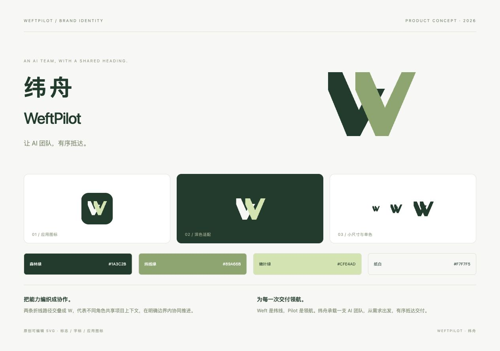

<p align="center"></p>

# 纬舟 WeftPilot

**让 AI 团队，有序抵达。**

一个用于组织角色、团队、项目和任务的 AI 桌面工作台。本仓库独立维护产品方案、品牌素材和可点击原型。

当前分支为 `product-design`，维护产品设计、交互原型和设计评审记录；[`main`](https://github.com/CerrorJ/weftpilot/tree/main) 维护开发源码、架构与开发规范。设计变更通过功能开发逐项落实到主分支，不将演示代码整体合并到正式应用。

当前处于产品设计阶段。原型中的 CLI 执行、模型调用、Git 操作、技能安装与飞书授权均为模拟，尚未连接真实执行服务。

## 运行原型

需要 Node.js 22 或更新版本，无需安装第三方依赖：

```sh
npm run dev
```

打开 [交互原型](http://127.0.0.1:4180) 或 [品牌与 Logo](http://127.0.0.1:4180/brand.html)。

```sh
npm run check
```

## 主要页面

工作台、项目管理、任务管理、需求管理、角色管理、团队管理、技能中心、设置。

- 角色创建：基本信息 → CLI/模型 → Skills → 权限边界 → 飞书连接 → 试运行与启用。
- 项目管理：展示 Git 地址、默认分支、当前分支、工作目录和关联任务。
- 任务执行：执行前检查 → 排队/开始 → 步骤进度 → 审批/异常处理 → 交付 → 验收或退回修改。
- 每次重试保留独立 Run 与配置快照；角色草稿和演示数据保存在本机浏览器，可在设置重置。

## 产品资料

- [产品设计索引](docs/product/00-index.md)
- [角色创建与生命周期](docs/product/02-role-lifecycle.md)
- [任务执行与验收](docs/product/03-task-execution.md)
- [遗漏清单与版本规划](docs/product/04-gaps-and-roadmap.md)
- [服务集成合同草案](docs/product/05-integration-contract.md)
- [名称、Logo 与品牌](docs/product/06-brand.md)
- [中文协作规范](AGENTS.md)

## 目录

```text
index.html             原型应用入口
brand.html             品牌与 Logo 展示
src/                   原型页面、状态和样式
assets/brand/          原创 SVG 标志与应用图标
docs/product/          产品方案、流程、缺口与集成边界
design/screenshots/    关键界面截图
scripts/               本机预览和静态检查
.superdesign/          设计系统、画布信息与可恢复上下文
```

本仓库与执行服务分别维护，不包含后台凭据、运行会话或真实业务数据。Superdesign 设计使用自行编写 HTML 后导入的方式，不调用付费生成。

## 设计评审

[Superdesign 画布](https://superdesign.dev/teams/325715a5-aa93-46d3-85d3-eb48ac1245d5/projects/6031de23-9bd4-46fe-bb93-09c040d0b26d)：角色试运行、执行前检查、单次审批、交付验收、品牌与 Logo。画布为静态评审画面，本机原型提供完整交互。


