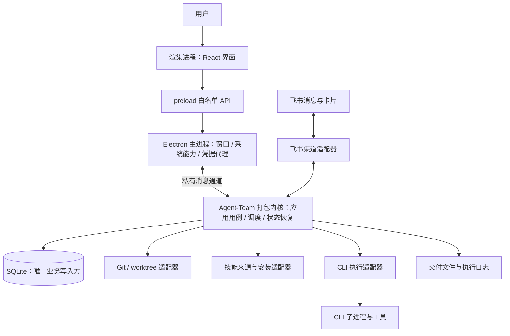
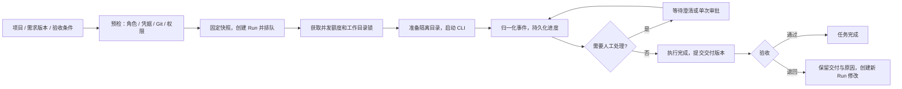

# 纬舟架构设计 v0.2

状态：**用户已确认技术栈、首版范围、运行方式和 macOS/Windows，内核方向明确为打包 Agent-Team**。本轮只更新架构与规范，正式实现由另一台设备的 Codex 按后续开发指令开展。

## 1. 产品边界

2026-10-22 已收到正式开发授权；上文“本轮”指 v0.2 设计会话。当前真实工程和验收状态以 [开发交接](../development/progress.md) 为准，本文其余内容保留为架构基线，不等于所有能力均已实现。

核心闭环：创建角色 → 组建团队 → 绑定项目仓库 → 整理需求 → 创建任务 → 执行与人工处理 → 交付验收。

已确认：角色配置 Skill、CLI、模型；技能市场安装；项目展示 Git 地址和分支；任务绑定项目并展示状态和进度；角色创建衔接飞书控制台；桌面驱动现有能力，保留飞书入口。

已确认首版：单设备、单所有者、本机执行、一个项目一个主 Git 仓库，支持多个项目、角色和团队。团队表示 AI 角色的协作组织，不等同于多人账号系统。多人协作、跨设备数据同步、远程 Worker、云端托管和多仓库编排列入后续。跨设备开发不表示首版可以同步运行数据。

## 2. 技术栈与已确认方向

| 层次     | 建议                                                     | 理由与约束                                               |
| -------- | -------------------------------------------------------- | -------------------------------------------------------- |
| 桌面壳   | Electron                                                 | 沿用现有 Node.js/TypeScript CLI 能力；接受包体和内存成本 |
| 界面     | React + TypeScript + Vite                                | 组件化实现已评审原型，不直接管理进程和文件               |
| 运行内核 | 将 Agent-Team 封装为版本化内核，在独立 Node 工具进程运行 | 内核源码继续在 Agent-Team 维护，纬舟消费打包产物         |
| 数据库   | 本机 SQLite，业务表 + 持久事件表                         | 内核唯一写入，状态、事件、幂等记录原子提交               |
| 通信     | preload 白名单 API + Electron IPC + 私有 MessagePort     | 首版不提供通用 HTTP 管理端口                             |
| 凭据     | 主进程提供系统凭据存储适配器                             | 内核受限取用，数据库只保留凭据引用                       |
| 契约     | Zod 运行时校验 + TypeScript 类型                         | 校验 IPC、CLI 事件、飞书输入和导入文件                   |
| 工程     | pnpm workspace；受支持的 Node.js LTS 工具链              | 初始化时验证并锁定版本，Electron 内嵌 Node 单独验证      |
| 质量     | ESLint、Prettier、类型检查、单元/集成/桌面流程测试       | 初始化后固化命令和 CI                                    |

Electron + React + TypeScript 已确认；具体版本、SQLite 驱动、凭据存储和 CLI 跨平台兼容仍需 M0 验证。首版覆盖 macOS、Windows。当前不安装业务依赖。

Electron 进程机制见[官方进程模型](https://www.electronjs.org/docs/latest/tutorial/process-model)和[utilityProcess 文档](https://www.electronjs.org/docs/latest/api/utility-process)。本方案采用工具进程以复用 Node 能力、隔离执行负载。

## 3. 进程与信任边界



- 渲染层展示读模型、提交业务命令、显示处理中和失败，不直连数据库、启动 CLI 或读取已保存凭据。
- preload/主进程提供有限接口、验证消息来源，管理系统对话框、外部链接、凭据和内核生命周期。
- 运行内核裁决任务状态、调度、审批和恢复，编排真实 CLI、Git 与持久化。
- 飞书将消息转成同一套应用命令，基于已提交事件更新卡片，不维护第二套状态机。
- CLI/Skill 属于外部执行边界。权限必须落实到实际工具能力；提示词不能作为系统级沙箱。

关闭窗口时保留托盘和主进程，内核可继续工作；完全退出时先处理运行任务并等待终止确认。首版不承诺主进程退出后任务仍可靠运行。系统服务或独立 daemon 后续再设计。

内核崩溃时显示“连接中断/状态待确认”，重新读取持久状态。进程对账完成前不能直接认定任务失败、停止或可以安全重跑。

## 4. 两仓职责与工程目录

**Agent-Team 是内核唯一源码来源，纬舟不重新开发一套内核。** 现有入口与飞书耦合，需要在 Agent-Team 中渐进解耦、扩展后形成可打包入口；打包现有入口不代表已经完成无飞书依赖的内核。

纬舟仓库规划：

```text
apps/desktop/
  main/            窗口、托盘、凭据桥接、内核宿主与退出控制
  preload/         白名单桥接
  renderer/        React 页面、交互、客户端状态投影
packages/
  kernel-client/   连接、协议校验、事件订阅、超时与版本协商
  ui/              需要复用时再提取的组件与视觉变量
config/            内核版本和产物摘要锁定（工程阶段建立）
assets/brand/      品牌源文件
build/             内核获取与装配脚本，产物不作为源码提交
docs/              架构、规范、确认与联调记录
tests/             桌面、客户端契约和打包集成测试
```

Agent-Team 内部继续维护：领域对象、用例、任务状态机、调度、审批、CLI、Git、Skill、持久化、飞书渠道和工具入口。按需要抽出通用内核、契约包、嵌入式入口与原飞书入口；具体内部目录在 M0 结合现有源码确定，保留原服务的启动兼容，不要求一次性搬动所有源码。

依赖方向：纬舟 renderer → 白名单 bridge → kernel-client/宿主 → Agent-Team 内核。内核领域与用例不依赖 Electron 或 React，飞书和桌面是同一内核的渠道。共享协议由 Agent-Team 定义并发布，纬舟消费锁定版本，不各自复制协议类型。

| 能力                                  | 源码归属                          | 纬舟职责                           |
| ------------------------------------- | --------------------------------- | ---------------------------------- |
| 项目、角色/团队、模型配置、需求、任务 | Agent-Team 内核；现有缺项在此扩展 | 页面、表单、选择和展示             |
| Run、并发、依赖、审批、停止、恢复     | Agent-Team 内核                   | 提交命令、显示权威状态和待处理事项 |
| CLI、Git、Skill 市场/安装、交付验收   | Agent-Team 内核及适配器           | 向导、证据预览、明确的用户动作     |
| 数据库、持久事件、outbox、工作区锁    | Agent-Team 内核唯一写入           | 不直连、不另建业务状态机           |
| 飞书消息、卡片与路由                  | Agent-Team 渠道适配器             | 连接管理与状态展示                 |
| 窗口、托盘、系统对话框、凭据代理      | 纬舟桌面宿主                      | 提供有限系统能力接口               |
| 界面偏好、页面缓存                    | 纬舟                              | 非敏感、不作为业务真相             |

开发中允许同步修改 Agent-Team，以满足内核解耦、协议、持久化和跨平台需求。两仓分别提交与测试，桌面锁定发布产物；不得把 Agent-Team 业务代码复制到纬舟形成第二份实现。详见[内核打包与两仓协作](kernel-integration.md)。

## 5. 角色创建

1. 草稿：名称、职责、角色标识和团队；支持恢复。
2. 执行配置：选择 CLI、模型，检测版本、认证和能力，展示不兼容原因。
3. Skill：选择并安装指定版本，锁定来源、提交和摘要；角色引用已安装版本。
4. 权限：工作目录、工具策略、网络、可写范围、并发和预算；检查 CLI 能否落实约束。
5. 飞书连接（可选）：绑定已有应用，或从向导打开控制台创建，再回填绑定并检测权限、事件和可见范围。
6. 试运行与启用：独立测试目录、低影响探针、生效配置与证据；通过后生成可执行角色版本。

角色可以在本地独立启用，不以飞书连接作为全部角色的前提。配置变更产生新版本，仅影响后续 Run；停用禁止新派发，现有 Run 通过明确停止动作处理。

“直接拉取飞书控制台创建”保留为产品目标。自动列出可管理应用、自动新建应用、权限开通和发布的可用接口尚未验证。M0 验证后决定官方 API 自动化或控制台辅助流程，不以抓取页面和长期保存控制台 Cookie 作为核心依赖。

## 6. 任务执行



任意阶段可能失败、取消或请求停止，完整规则见[数据与协议](data-and-protocol.md)。

- 预检展示阻塞项；真正执行前再次检查仓库、角色和凭据，避免排队期间结果过期。
- 默认一个 Run 一个 Git worktree；项目页展示默认分支、当前分支、Run 分支和基准提交。非 Git 目录是否支持待评审。
- 限制全局并发、角色并发和工作目录写入并发；依赖未满足时展示具体依赖。
- 只有总步骤明确时显示百分比；CLI 沉默时显示最后活动时间，不制造进度。
- 保留原生会话引用、进程身份和执行片段。既有服务审批会结束 CLI，再启动续接片段，不等同于冻结并恢复同一进程。
- 执行成功进入待验收；合并、推送和发布需要明确动作，不因执行成功自动发生。

## 7. 非功能目标

以下为建议验收目标，待真实设备测量：

- 本地查询/已持久化命令受理 P95 小于 300ms，不含网络、CLI 启动和推理。
- 控制事件可靠投递；高频日志分批存储和展示并设上限，防止输出洪水。
- 任务分页、日志虚拟列表；大文件和完整日志不直接进入事件 payload。
- 数据迁移前备份并演练恢复；SQLite 不放网络共享目录。
- 渲染层沙箱、上下文隔离、禁用 Node 集成、白名单桥接、CSP、IPC 来源校验遵循 [Electron 安全建议](https://www.electronjs.org/docs/latest/tutorial/security)。
- 外部 Markdown、CLI 输出与产物预览清理脚本和危险链接；诊断包脱敏后由用户明确导出。

当前只交付架构资料，没有工程初始化、内核封装实现、真实 API 或安装包。已确认方向见[评审记录](review.md)，在开发设备收到开发指令后从 M0 开始。
