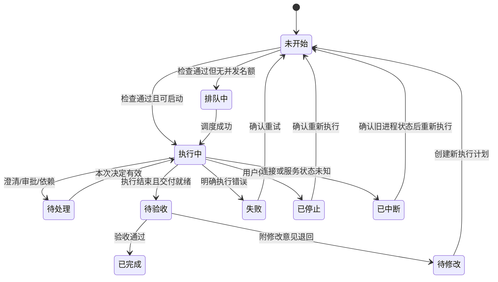

# 任务执行、异常恢复与验收

## 任务与 Run 分开

任务记录目标、所属项目、关联需求、负责人、优先级、依赖、计划和验收标准。每次真正执行建立一个 Run，固定角色配置、CLI、模型、Skills 版本、权限、Git 基线、执行分支和工作目录。

一个任务可以有多个 Run。重试保留先前结果并创建新 Run；不能只把失败标签改成执行中。重新验收或退回修改也是独立记录。

## 执行前检查

创建任务 → 完善验收标准 → 选择角色/团队 → 检查 → 进入队列或执行。

| 检查对象 | 必须确认的内容 | 不通过时 |
| --- | --- | --- |
| 归属 | 项目存在，任务关联的需求属于同项目 | 阻止保存或修正关系 |
| 计划 | 有明确目标、步骤、依赖、验收标准 | 请求补充或澄清 |
| 成员 | 角色启用，模型、工具和权限可用 | 指向角色或设置中的具体问题 |
| Git | 仓库可访问，基准分支存在，未提交改动与冲突已处理 | 阻止启动，给出保留现有改动的处理路径 |
| 隔离 | 为并行任务准备独立分支和目录 | 不允许静默共享一个可写工作目录 |
| 调度 | 依赖通过，角色有并发名额，预算与时间限制允许 | 排队并显示具体等待原因 |

首版默认独立目录；共享目录只用于明确知道影响的串行任务。界面区分项目默认分支、项目当前分支、Run 实际执行分支；开始后以执行端回传的真实分支为准。

## 状态

排队尚未启动，不应填入开始时间或假造运行耗时。待处理必须附具体原因和下一步操作。执行中断时先核实旧进程，避免前端重连就启动第二个任务。

## 进度与时间

- 默认展示“已完成 2/5，正在执行第 3 步”，并附负责人、最近事件和更新时间。
- 百分比只能根据显式计划步骤计算；步骤变更需要保留计划版本，不把工具调用次数当工作量。
- 没有稳定计划时显示阶段与事件；不伪造剩余时间。
- 任务总耗时分为排队、执行、等待人工处理和验收四种时间，避免用户把等待审批误认成模型耗时。
- 分配给团队时展示子任务和依赖。父任务完成需要所有必需子任务通过验收，而非负责人发出一句“已完成”。

## 人工处理

澄清、产品方案确认、敏感操作审批和交付验收具有不同语义，在统一待处理入口汇总，进入任务后执行对应动作。

审批记录绑定任务、Run、操作者、动作参数摘要与有效期。桌面和飞书共享决定状态；任一渠道先处理后，另一渠道显示已处理。拒绝、过期、撤销和旧版本请求均不能继续放行。

## 失败、停止、重试

- 限流且尚未执行副作用的调用可按明确策略重试，并显示次数和等待原因。
- 已经写文件、创建远程资源或执行外部动作后，不应把整段任务当作无副作用请求盲目重放。
- 停止结束当前执行，但不承诺回滚已经写入的文件或外部动作。
- 新 Run 开始前检查旧进程、工作目录与已有交付，用户可以选择保留改动后继续或从干净基线重新开始。
- 取消排队与停止执行分开呈现；已取消任务保留历史记录。

## 交付与验收

完成步骤 → 交付版本 → 文档/代码差异/验证记录 → 逐项检查验收标准 → 通过或附意见退回。

代码类任务至少有变更摘要、实际分支/提交或差异、运行的验证命令和结果；方案类任务有版本、范围与验收标准。证据不足时允许退回。

通过记录操作者、时间、任务需求版本、Run 和交付版本。退回保留原产物，下一次执行继承修改意见；不能用重新生成覆盖原来的验收依据。

## 原型边界

当前原型实现上述主要用户决策的可点击演示、配置快照、历次 Run、草稿与浏览器恢复。真实队列调度、文件隔离、SDK 调用、可恢复进程和服务事件流仍需后端实现。
